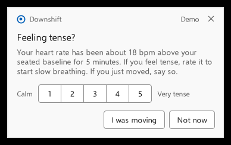
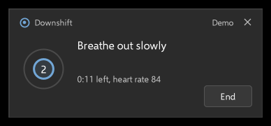

# Downshift

Downshift is a small Windows app for studying with a WHOOP strap. It runs timed study blocks with breaks, guides slow breathing, and asks whether you feel tense when your seated heart rate stays raised. Every default is taken from published research, and the app says which numbers are tested and which are reasoned starting points.

<p>
  
  
</p>

## Status

This is an early release. The logic is covered by automated tests and the whole app has been run end to end against a simulated strap. It has **not yet been verified with a real WHOOP on a real Windows PC**. If you try it, please open an issue with what you found, whether it worked or not.

## What it does

- **Study blocks and breaks.** 25 minutes of work, a 5-minute break, and a 20 to 30 minute break after about two hours. You get a two-minute warning, can delay twice, and can note where to pick up.
- **Guided breathing.** Five minutes at six breaths a minute (4 seconds in, 6 out), with a visual pacer, optional spoken cues and tones. Cyclic sighing and box breathing are available as alternatives.
- **Heart rate nudge.** During a study session, if your heart rate holds about 15 bpm above your seated baseline for five minutes, a silent box asks "Feeling tense?". It never tells you that you are stressed, because heart rate alone cannot show that.
- **Your own data.** Each breathing session records how tense you felt before and after. The log is a plain CSV file on your PC.
- **Pairing.** Downshift connects only to the strap you choose, and shows its live reading so you can confirm it is yours.

Nothing leaves your computer. There is no account, no telemetry and no network access.

## Install

1. Download `Downshift.exe` from the [Releases](../../releases) page.
2. Run it. Windows may warn that the publisher is unknown, because the file is not code-signed; choose **More info**, then **Run anyway**.
3. In the WHOOP app, turn on **Broadcast Heart Rate**.
4. On Downshift's **Device** page, pick your strap from the list and choose **Pair with selected strap**.

Requirements: Windows 10 (version 1803 or later) or Windows 11, with Bluetooth. Nothing else needs installing; the app uses the .NET Framework that ships with Windows.

The study timer and breathing guide work without a strap.

## Using it

Downshift lives by the clock in the taskbar. The tray icon shows your live heart rate.

| To do this | Do this |
|---|---|
| Open the main window | Double-click the tray icon |
| See the status box | Click the tray icon |
| Start studying | **Start study session**, on the Home page or the status box |
| Breathe now | **Breathe**, in the tray menu or on the Home page |
| Silence everything | **Mute sounds**, in the tray menu or Settings |
| See why a default is what it is | The **Evidence** page |

## What to expect

Slow breathing reliably makes people feel calmer for a short while, and regular short breaks reliably reduce fatigue. No trial shows that breathing prompts or any break schedule raises grades. For marks, the strong evidence is for self-testing, spreading study over days, and sleeping well.

The heart rate nudge is deliberately modest. No study validates heart rate alone as a stress detector, and most real study stress is too small to trigger it. Use **Breathe** whenever you feel tense, and treat the nudge as an occasional reminder.

[docs/evidence.md](docs/evidence.md) lists each default with the research behind it. [docs/evidence-review.md](docs/evidence-review.md) is the full review with 91 sources.

## Build from source

You need the [.NET 8 SDK](https://dotnet.microsoft.com/download). The app targets .NET Framework 4.7.2 and builds on Windows, Linux or macOS.

```
dotnet build Downshift.sln -c Release
dotnet run --project tests/Downshift.Tests -c Release
```

The executable is written to `src/Downshift/bin/Release/net472/Downshift.exe`. It is a single file of about 170 KB with no other files to ship.

See [docs/architecture.md](docs/architecture.md) for how the code is organized and [CONTRIBUTING.md](CONTRIBUTING.md) for how to work on it.

## Troubleshooting

If the strap won't connect, see [docs/troubleshooting.md](docs/troubleshooting.md). The Bluetooth log, under Settings, General, records what the app saw and is the most useful thing to attach to a bug report.

## Not a medical device

Downshift is a self-regulation aid. It does not diagnose, treat or monitor any condition. A racing heart with chest pain, faintness or trouble breathing needs medical care, not a breathing exercise.

Downshift is an independent project. It is not affiliated with, endorsed by or supported by WHOOP, Inc. WHOOP is a trademark of its owner. The app reads only the standard Bluetooth heart rate broadcast that the strap offers to any fitness device.

## License

[MIT](LICENSE)
