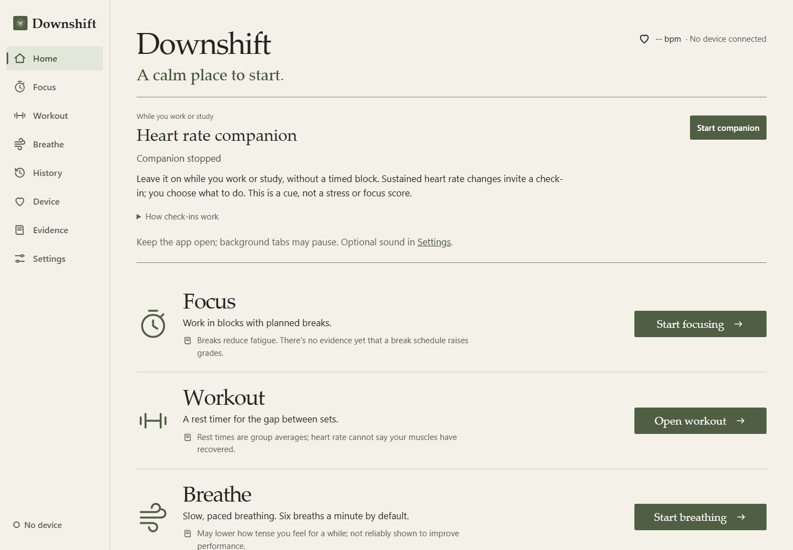
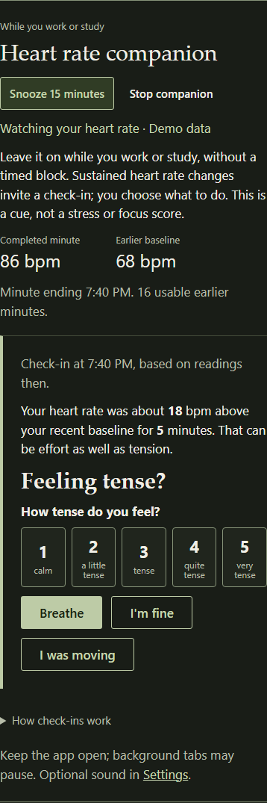
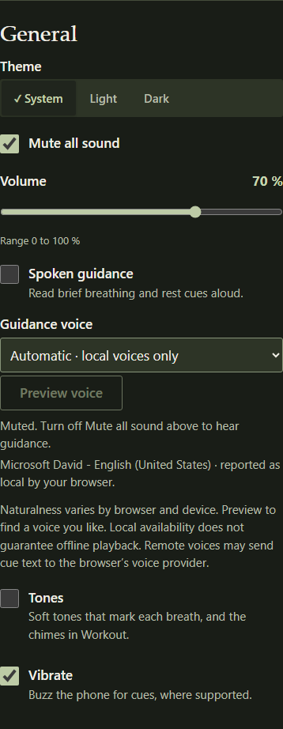
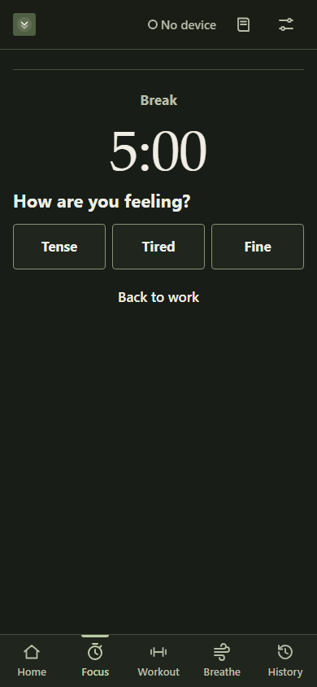
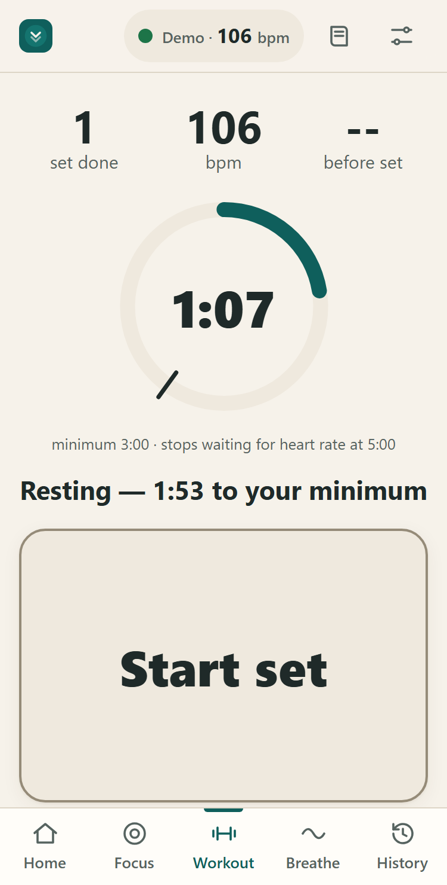
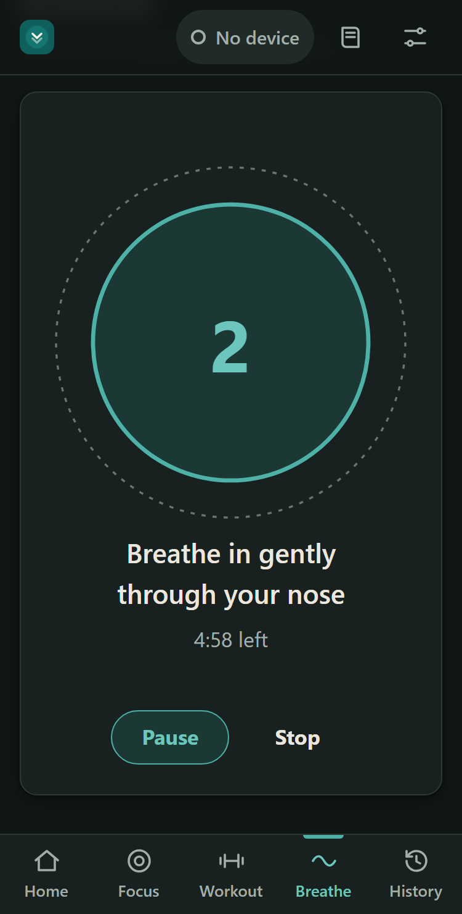

# Downshift

A quiet heart rate companion for work or study, plus focus blocks, rest timers and guided breathing. Connect a WHOOP or another Bluetooth heart rate monitor for optional check-ins.

[](https://github.com/eligorelick/downshift/actions/workflows/ci.yml)
[](LICENSE)

**[Open the web app](https://eligorelick.github.io/downshift/)** · **[Windows release status](https://github.com/eligorelick/downshift/releases)**

<p>
  
</p>

<p>
  
  
</p>

The companion and voice images show narrow layouts at their full content height; the heart rate example uses demo data.
<p>
  
  
  
</p>

Downshift runs in the browser and can also be run from source as a Windows app. The timers and breathing work without a heart rate device. Research informs the defaults, and the Field Guide distinguishes studied practices from product choices and unvalidated heart rate rules.

## Features

- **Heart rate companion.** Start once on Home while working or studying, without logging manual Focus blocks. Sustained heart rate changes can prompt a gentle check-in and optional guided breathing. Snooze for 15 minutes or Stop at any time. The app shows a completed minute's median and a lagged baseline; these are measurements, not a stress or focus score.
- **Focus.** Optional work blocks and breaks: 25/5 minutes (School) or 45 minutes (Work), with a two-minute warning, two snoozes and a note for where to pick up. Each break asks how you feel (tense, tired or fine) and suggests breathing, a walk or time away from screens.
- **Workout.** A rest timer between sets. The minimum rest comes from your goal (strength, size or endurance), and heart rate never shortens it. Once the minimum has passed, it can tell you your heart rate is still elevated.
- **Breathe.** A visual pacer with optional spoken guidance and tones, silent on a fresh install. Six gentle, unforced breaths a minute for five minutes by default, with cyclic sighing and box breathing as options, and a tension rating before and after. Stop if you feel dizzy or uncomfortable.
- **History.** A log of your sessions, how sharp you felt by time of day, and CSV export.

## Heart rate devices

Tested with **WHOOP 5.0** on the Windows app. Turn on **HR Broadcast** in the WHOOP app (Device settings), then connect from Downshift's Device page.

Downshift reads the standard Bluetooth Heart Rate Service, so other devices that broadcast it, such as chest straps, Fitbit Charge 6, Pixel Watch and Garmin watches, should also work. Setup steps for each are in [docs/platform-support.md](docs/platform-support.md). A device usually streams to one receiver at a time, so disconnect it from other apps and equipment first.

Heart rate needs a browser with Web Bluetooth: Chrome or Edge on Windows, macOS, Linux and Android, or [Bluefy](https://apps.apple.com/app/id1492822055) on iPhone. In Safari, Firefox and other iOS browsers, the timers and breathing still work without heart rate.

## Getting started

**Windows app.** No Windows installer or portable executable is published on [GitHub Releases](https://github.com/eligorelick/downshift/releases) yet. Use the web app, or run the Electron app from source with `bun run desktop`. The Windows shell adds a tray icon with live heart rate and native notifications.

**Website.** Open <https://eligorelick.github.io/downshift/> in Chrome or Edge, or in Bluefy on iPhone. You can install it as an app, and it works offline after the first visit.

**Connect your device.**

1. Turn on heart rate broadcasting on your device.
2. In Downshift, open **Device** → **Connect a heart rate device** and choose your device.
3. Check that the live reading matches your device.

No device? **Device** → **Try demo data** runs everything on a simulated heart rate.

**Use the companion.** Choose **Start** in the Heart rate companion on Home. Keep the app open while you work or study. It first lets heart rate settle, then needs several usable minutes to learn a baseline. A check-in asks how you feel; it cannot tell whether you are stressed or how well you are working. **Snooze** pauses check-ins for 15 minutes and starts fresh learning afterward. **Stop** clears pending companion notices and sound. Settings also retains **In focus** monitoring for people who prefer timed Focus sessions.

Monitoring pauses during Workout, active breathing and timed breaks, and restarts learning after connection loss, stale readings, reported loss of skin contact or a source change. Gaps are not filled with guessed readings. Browsers may suspend background tabs; closing the app stops live monitoring. Optional notifications require the **Enable notifications** gesture and do not make background monitoring reliable.

**Optional sound.** Fresh installs and preference resets mute all sound and turn off spoken guidance, tones and break sounds; explicit saved choices are respected. To hear guidance, turn off **Mute all sound**, raise the volume and enable **Spoken guidance** in Settings. Choose a **Guidance voice** and use **Preview voice**. Naturalness varies by browser and device; automatic selection uses local voices only, and local availability does not guarantee offline playback.

## How the defaults were chosen

Each default is labeled *tested in studies*, *supported by smaller trials or associations*, or *a reasoned starting point*. The main points:

- Breathing exercises give a small-to-medium drop in self-reported stress, though in the largest blinded trial a placebo pace helped about as much.
- Short breaks reduce fatigue and raise energy. Their effect on performance is small and uncertain.
- Longer rests between sets help strength. No trial we know of shows that resting by heart rate improves gains, so the rest minimum is a clock and heart rate is advice only.
- Heart rate alone hasn't been validated as a stress detector, so the prompt asks how you feel instead of telling you. The companion's thresholds and timing are product starting points; they can miss stress or prompt for other reasons.

Downshift makes no promises about grades, strength or muscle gains. Each default and its sources are listed in [docs/evidence.md](docs/evidence.md). There are deeper reviews of [Workout and Work](docs/evidence-workout-work.md), [heart rate and thinking](docs/evidence-cognition.md), and the [full literature review](docs/evidence-review.md) of about 90 sources. Every DOI and PubMed ID was checked against Crossref and NCBI.

## Privacy

There's no account, app server, telemetry or analytics. Settings and history stay in your browser's storage (or the Windows app's own profile). Heart rate is not stored as a continuous recording; session and check-in summaries may include readings, such as heart rate at the start and end of a rest. You can export your history as CSV or delete everything from Settings. Guidance uses browser/system voices. Automatic voice selection stays local; an explicitly selected remote voice service may receive generic cue text. Heart rate values are not spoken or sent to that service.

## Development

Requires [Bun](https://bun.sh) 1.4.

```sh
bun install
bun run dev            # dev server with hot reload
bun run test           # unit tests: core, ble, app
bun run lint
bun run typecheck
bun run e2e            # Playwright; first run: cd packages/app && bunx playwright install chromium
bun run build          # website → packages/app/dist
bun run desktop        # run the Windows app
bun run desktop:dist   # installer and portable exe → packages/desktop/release
```

```
packages/core      Decision logic: nudge, focus clock, rest coach, breathing. No DOM, fully unit-tested.
packages/ble       Heart rate sources: Web Bluetooth and a simulator.
packages/app       React + Vite UI. Builds the website.
packages/desktop   Electron shell for Windows.
```

See [docs/architecture.md](docs/architecture.md) for how it fits together and [CONTRIBUTING.md](CONTRIBUTING.md) before opening a pull request. The original 0.1.0 Windows Forms app is preserved in the [first commit](https://github.com/eligorelick/downshift/tree/4ef898d5af933566dcfeb83621c86b761e31ac70).

## Troubleshooting

See [docs/troubleshooting.md](docs/troubleshooting.md). For connection problems, the Bluetooth log on the Device page shows what the app saw; attach it to bug reports.

## Disclaimer

Downshift is a timing and self-regulation aid, not a medical device. It doesn't diagnose, treat or monitor any condition. A racing heart with chest pain, faintness or trouble breathing needs medical care. Stop lifting if something hurts.

Downshift is an independent project, not affiliated with or endorsed by WHOOP, Fitbit, Google, Apple, Polar or Garmin. Their names are trademarks of their respective owners.

## License

[MIT](LICENSE). Bundled third-party packages and their licenses are listed in [THIRD_PARTY_NOTICES.md](THIRD_PARTY_NOTICES.md).
